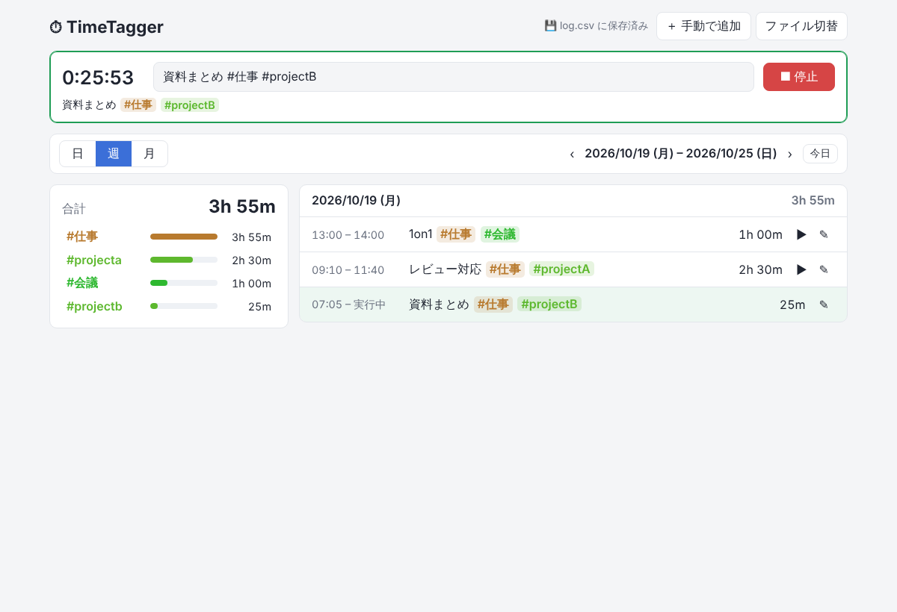

# TimeTagger

タグで分類するシンプルな時間記録アプリです。
**`timetagger.html` 1 ファイルだけで動き**、記録は手元の **CSV ファイル**に保存されます。
インストール・インターネット接続・サーバーは不要です。



## 配布と起動

1. `timetagger.html` を配布し、受け取った人は好きなフォルダに置く
2. ダブルクリックしてブラウザ（**Chrome または Edge 推奨**）で開く
3. 最初に記録先の CSV を選ぶ
   - **新しい CSV ファイルを作成** … 例: `timetagger-log.csv` を作る
   - **既存の CSV ファイルを開く** … 前に使っていたログを続ける
4. 以降は記録を変更するたびに、その CSV ファイルへ自動で上書き保存されます
5. 次に開いたときは「前回のファイルで続ける」を押すだけで再開できます（ブラウザが許可を求めます）

### Firefox / Safari の場合

これらのブラウザは CSV ファイルへの直接保存に対応していないため、
「CSV ファイルを読み込む」で開き、作業後に **「CSVを保存」** ボタンでダウンロードしてください。
保存前のデータもブラウザ内には残っています。

## 使い方

- **タイマー**: 作業内容に `#タグ` を付けて入力し ▶ 開始 / ■ 停止。計測中も内容を編集可能
- **タグ**: `#仕事` `#projectA` `#client/abc` など。日本語も可、大文字小文字は区別しません
- **記録一覧**: ▶ で同じ内容をもう一度計測、✎ で編集・削除
- **手動で追加**: 過去の作業を開始・終了時刻を指定して追加
- **レポート**: 日 / 週 / 月ごとの合計とタグ別内訳。タグをクリックで絞り込み（複数選ぶと AND 条件）

1 つの記録に複数タグがある場合、その時間は各タグにそれぞれ計上されます。

## CSV ファイルの形式

UTF-8（BOM 付き）なので Excel でそのまま開けます。

| 列 | 内容 |
| --- | --- |
| `id` | 記録の ID（空欄でも読み込み可。自動で付番） |
| `start` | 開始日時 `2026-10-19 09:00:00` |
| `end` | 終了日時。空欄は計測中 |
| `duration_hours` | 時間（時間単位、小数 2 桁）※読み込み時は無視 |
| `tags` | 説明から抽出したタグ ※読み込み時は無視 |
| `description` | 作業内容（タグを含む） |

### 注意

- **アプリで使用中の CSV を Excel で開いたままにしないでください。** Windows ではファイルがロックされ保存できません。
  その場合は画面上部に「⚠ 保存できません」と表示されるので、Excel を閉じてから「再試行」を押してください（データは失われません）。
- Excel で編集して保存した CSV（`2026/10/19 9:00` 形式の日時、Shift_JIS）もそのまま読み込めます。
- アプリを開いている間に別のアプリで CSV が変更された場合は、上書きするか読み込み直すかを確認します。

## 開発者向け: 動作テスト

Playwright で `file://` から開いて主要な操作を確認します（ファイル選択ダイアログは疑似ファイルに置き換え）。

```bash
NODE_PATH=$(npm root -g) node test/e2e.cjs
```
